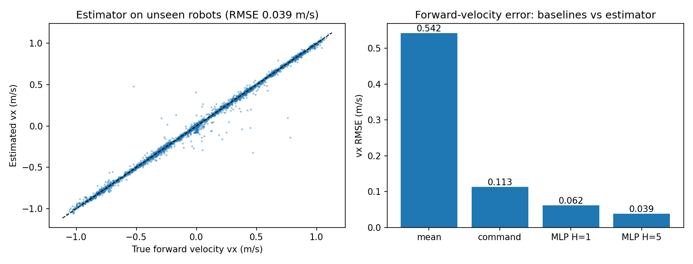

# Blind Quadruped Locomotion with PPO

Velocity-tracking policies for the Unitree Go2 trained with PPO in **Isaac Lab 3.0** (Newton physics, rsl_rl), on a single **8 GB laptop GPU**. The project asks one question that matters for real robots: **what happens when a locomotion policy cannot measure its own velocity?**

Built as preparation for the Inter IIT Tech Meet 15.0 problem statement on high-speed *blind* locomotion for a wheeled-legged quadruped, where the robot has only joint encoders and an IMU.

## Key finding

The stock Isaac Lab velocity task feeds the policy the robot's **true base linear velocity** (`base_lin_vel`), which no onboard sensor measures directly. I removed it and measured the cost, then tested whether a privileged critic can recover it.

| Variant | Actor sees velocity | Critic sees velocity | Velocity error | Yaw-rate error | Fall rate | Mean reward |
| --- | --- | --- | --- | --- | --- | --- |
| A. Privileged (stock) | Yes | Yes | **0.117 m/s** | 0.158 rad/s | 2.5% | 33.2 |
| B. Blind | No | No | 0.172 m/s | 0.166 rad/s | 2.5% | 30.7 |
| C. Blind + asymmetric critic | No | Yes | **0.139 m/s** | 0.152 rad/s | 2.2% | 32.3 |

All runs: 4,096 parallel environments, 1,500 PPO iterations (~147M environment steps), flat terrain, same seed and hyperparameters. Values are from the final training iteration.

**What this shows**

- **Blindness costs tracking, not stability.** Removing velocity left the fall rate unchanged but raised velocity-tracking error by about 47%.
- **A privileged critic recovers about 60% of that loss with no new sensor.** In variant C the deployed actor sees exactly the same inputs as in B. Only the critic, which exists during training alone, receives the true velocity, giving more accurate advantage estimates.
- **The remaining gap (0.139 vs 0.117 m/s) is what an explicit learned velocity estimator targets** (next section).

## Learned velocity estimator (offline)

Can the missing velocity be recovered from the signals a blind robot *does* have? I logged 384,000 samples (256 robots x 30 s) from the blind-actor policy (variant C), recording the actor's 45 blind inputs and the simulator's true base velocity. A small MLP (256-128-3, ~45k parameters) was then trained to predict body-frame velocity from a short history of those inputs. Test robots were held out entirely (80/20 split by robot, not by time step).

| Predictor | vx RMSE | vy RMSE | vz RMSE |
| --- | --- | --- | --- |
| Mean velocity (no information) | 0.542 m/s | 0.557 m/s | 0.071 m/s |
| Commanded velocity ("robot does what it's told") | 0.113 m/s | 0.126 m/s | 0.071 m/s |
| MLP, 1-step input (20 ms) | 0.062 m/s | 0.047 m/s | 0.040 m/s |
| **MLP, 5-step history (100 ms)** | **0.039 m/s** | **0.033 m/s** | **0.029 m/s** |



- **The estimator recovers velocity from IMU and joint signals alone.** With 0.1 s of history it is about 3x more accurate than assuming the robot follows its command (forward error 0.039 vs 0.113 m/s).
- **History matters.** Going from 1 step to 5 steps cuts forward-velocity error by 38%, consistent with velocity being inferred from how joint and IMU signals evolve over time.
- **This is offline only.** The estimator has not yet been fed back into the policy. Closing that loop (training it concurrently with PPO, as in Ji et al. 2022) is the next step.

## Training length

| Run | Iterations | Environments | Fall rate | Velocity error | Time |
| --- | --- | --- | --- | --- | --- |
| Short (default) | 300 | 2,048 | 18.3% | 0.54 m/s | 2.9 min |
| Full | 1,500 | 4,096 | 2.5% | 0.12 m/s | 17 min |

The default 300 iterations leaves the policy undertrained; 1,500 iterations cuts falls by 7x and tracking error by 4.5x.

## Setup

| Item | Value |
| --- | --- |
| Simulator | Isaac Lab 3.0, Newton physics (MuJoCo-Warp solver), no Isaac Sim |
| Algorithm | PPO (rsl_rl): clip 0.2, gamma 0.99, GAE lambda 0.95, 5 epochs x 4 minibatches, adaptive KL learning rate |
| Networks | Actor and critic MLP [128, 128, 128], ELU (~41k actor parameters) |
| Control | 12 joint-position targets at 50 Hz, PD control underneath |
| Hardware | RTX 5050 Laptop GPU (8 GB), Windows 11 |

**Actor observations (blind variant, 45 dims):** base angular velocity, projected gravity, velocity command, joint positions, joint velocities, previous action. All are measurable with an IMU and joint encoders.

## Repository contents

```
configs/   git diffs of each variant against stock Isaac Lab 3.0
scripts/   log_velocity_data.py (rollout logger), train_velocity_estimator.py
results/   estimator results.json
notes/     ppo_annotated.py (rsl_rl PPO with block-by-block notes)
media/     estimator plot
```

## Reproduce

```powershell
git clone https://github.com/isaac-sim/IsaacLab.git --branch release/3.0.0
cd IsaacLab
git apply configs\2026-11-01_12-45-25_asym.diff   # or ..._blind.diff; skip for the privileged baseline
uv run isaaclab train --rl_library rsl_rl --task Isaac-Velocity-Flat-UnitreeGo2 physics=newton_mjwarp --num_envs 4096 --max_iterations 1500
uv run isaaclab play --rl_library rsl_rl --task Isaac-Velocity-Flat-UnitreeGo2 physics=newton_mjwarp --checkpoint latest --viz newton_gl --num_envs 16

# velocity estimator (needs the asym config applied; copy scripts/ into IsaacLab/scripts)
uv run isaaclab -p scripts/log_velocity_data.py --task Isaac-Velocity-Flat-UnitreeGo2 physics=newton_mjwarp --num_envs 256 --checkpoint <asym model_1499.pt> --steps 1500
uv run --with matplotlib python scripts/train_velocity_estimator.py --data logs/velocity_data.pt
```

## Limitations

- One seed per variant; differences of a few percent (falls, yaw) are within run-to-run noise.
- Flat ground with the default, mild domain randomization. The gap is likely larger on rough terrain and under real disturbances.
- Evaluated in simulation only; no hardware deployment.
- Estimator data was logged without push disturbances, from a single policy; accuracy under pushes, payloads and other gaits is untested.
- The default randomization is much weaker than the target problem statement (10 kg payload, COM shifts up to 14 cm, 250 N pushes, unknown friction).

## Next steps

1. Feed the estimator into the actor and train it concurrently with PPO (after Ji et al. 2022, DreamWaQ), then measure whether it closes the remaining tracking gap.
2. Domain randomization matched to the target disturbances: payload, COM offset, friction, push forces.
3. Rough terrain with the height scan removed, to keep the policy blind.
4. Multiple seeds per variant for confidence intervals.

## Author

Vyom Divecha, B.Tech Mechanical Engineering, IIT Dharwad
